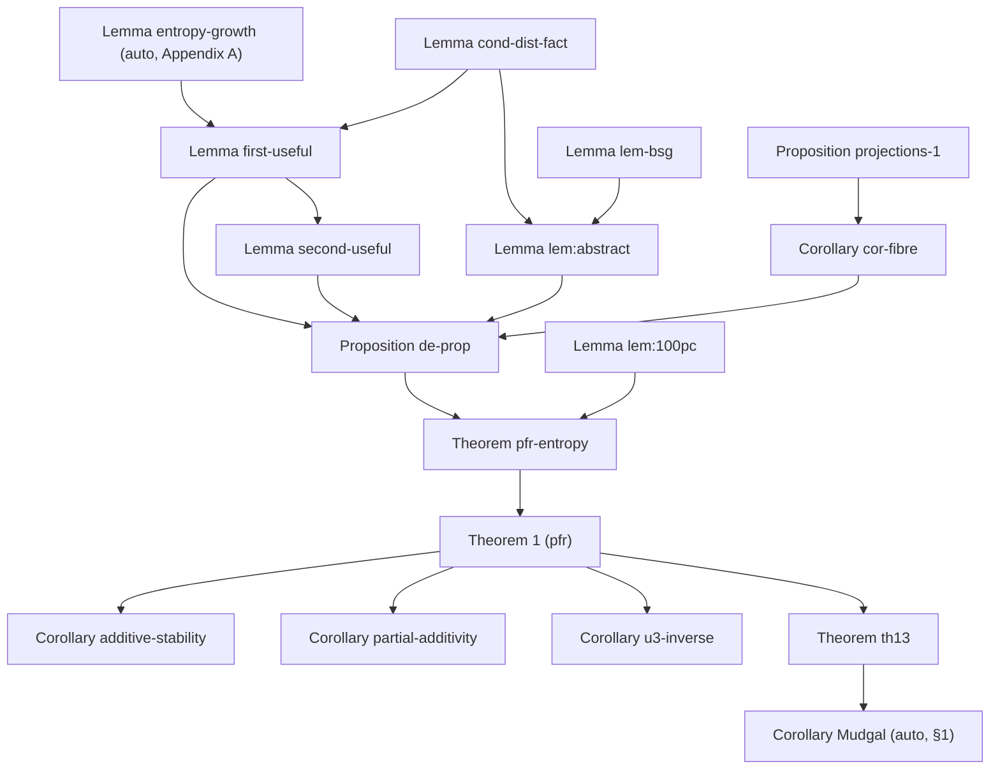

# On a conjecture of Marton：已核对的局部依赖图

2026-10-22 更新。依据 [结构记录](gowers2024_marton_structure.json) 和本地原文 [pfr2-submit.tex](paper/pfr2-submit.tex)。文件名沿用旧示例名称；本文只展示选定的 17 个实体，不代表全文提取完成。原文核对依据、引用范围和纠错候选见 [source-checks.md](source-checks.md)。

`B.dependencies` 含 `A` 表示明确前置边 `A → B`。入度是记录中的明确前置项数量，出度是直接依赖该结果的实体数量。外部引用与不确定关系均不计入这张确认图。表中数值来自 Python 标准库对当前 JSON 的实际计算。

| 实体 | 入度 | 出度 | 共享节点 |
|---|---:|---:|---|
| Theorem 1 (pfr) | 1 | 4 | 是 |
| Theorem pfr-entropy | 2 | 1 | 否 |
| Proposition de-prop | 4 | 1 | 否 |
| Lemma lem:100pc | 0 | 1 | 否 |
| Proposition projections-1 | 0 | 1 | 否 |
| Corollary cor-fibre | 1 | 1 | 否 |
| Lemma cond-dist-fact | 0 | 2 | 否 |
| Lemma first-useful | 2 | 2 | 否 |
| Lemma second-useful | 1 | 1 | 否 |
| Lemma lem:abstract | 2 | 1 | 否 |
| Lemma lem-bsg | 0 | 1 | 否 |
| Corollary additive-stability | 1 | 0 | 否 |
| Corollary partial-additivity | 1 | 0 | 否 |
| Corollary u3-inverse | 1 | 0 | 否 |
| Theorem th13 | 1 | 1 | 否 |
| Lemma entropy-growth (auto, Appendix A) | 0 | 1 | 否 |
| Corollary Mudgal (auto, §1) | 1 | 0 | 否 |

沿用本流程的“共享节点”定义：至少两个直接依赖者，且至少一个类型为 THEOREM。因此只有 pfr 满足条件；cond-dist-fact 被两个引理直接使用，但不满足后一个条件。该标签是图上的分类，不是数学重要性的判断。

当前图有 17 个实体、18 条明确边，无悬空边、反向引用不一致或环。最长路径为 8 个节点、7 条边，例如：

`cond-dist-fact → first-useful → second-useful → de-prop → pfr-entropy → pfr → th13 → Mudgal`。

用 entropy-growth 替换路径起点也得到同样长度。图自洽只说明所记录关系的结构一致，不证明这些数学结论正确，也不说明所有前置事实都已列出。

此次修正了原图的入度/出度方向和共享节点判断，补入原文附录中的无标签熵增长引理。`lem-bsg → lem:abstract → de-prop` 是原文明示的间接路径，不再另画不确定直连边；`cond-dist-fact` 的正式直接使用在 first-useful 和 lem:abstract 的证明中，也不另画它到 de-prop 的传递边。外部引用仍须随结果查阅，尤其是 th13 及三个 PFR 应用的外部论证。
