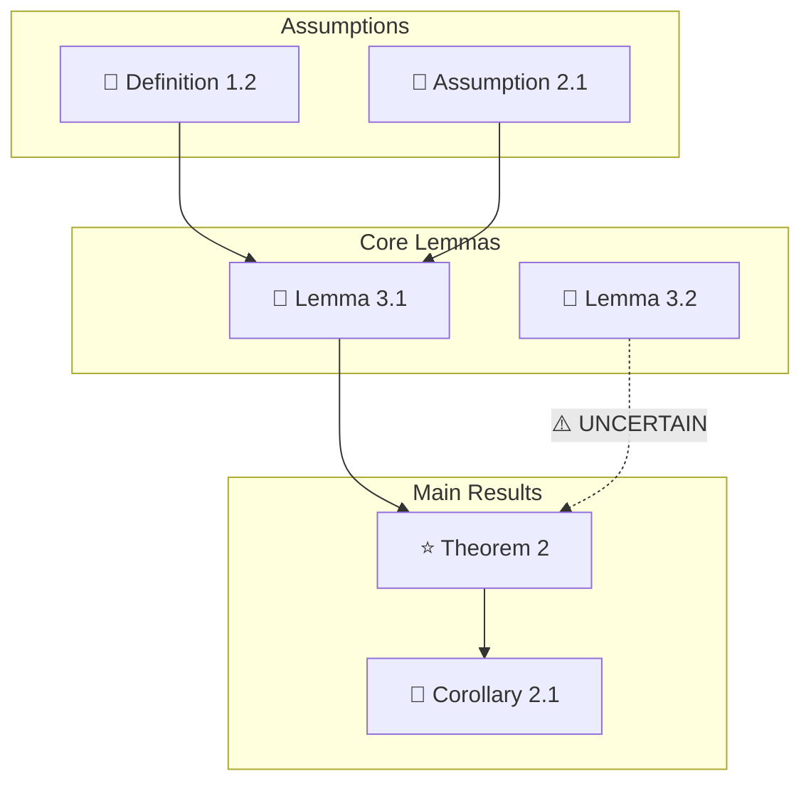
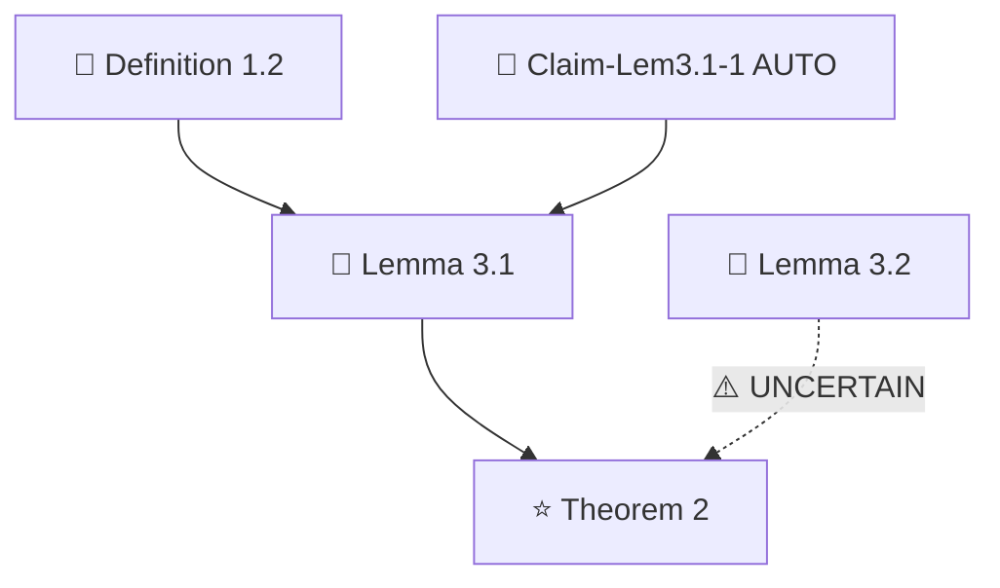

# 论文证明路径生成、引理/定理关系图构建

> **定位**：根据论文原文与可纠正的结构索引，计算并呈现当前已提取的证明依赖。
>
> **依据**：原文决定陈述和依赖关系；`<slug>_structure.json` 辅助定位与计算。可随时回查原文、更正实体和边，并同步已有 JSON、分析报告和图。只读局部原文时也可生成局部图，无需先生成全篇 JSON。

---

## 一、角色定位

你的任务是帮助读者追踪证明关系：

1. **原文核对**：核查本次涉及的陈述、实际引用句或证明使用位置；无法取得原文时明确标为未核查。
2. **图计算与渲染**：只对当前确认的内部依赖计算度数与拓扑，用 Mermaid 呈现。
3. **阅读路径**：给出从目标追溯前置结果、从前置结果读到目标的两种顺序。
4. **结构问题回查**：缺节点、环、孤立结果和 uncertain 边是进一步读原文的线索；图计算不证明数学正确性，也不自动判定论文错误。

### 数据来源与修正

| 数据源 | 用途 | 限制 |
|:---|:---|:---|
| 论文原文、作者源码或用户提供的片段 | 确认陈述、条件和依赖 | 记录实际读取的位置与覆盖范围；OCR 存疑时看页面 |
| `<slug>_structure.json` | 实体与关系索引、图计算输入 | 可能误引或遗漏，允许依据原文直接更正 |
| `<slug>_structure_analysis.md` | 已有分析说明与回查线索 | 与 JSON 冲突时回查来源，不自动采信任意一方 |

修正时用普通说明写出原文位置、原记录、修改和影响，同步已有 JSON、报告、图及 `cited_by`、度数、阅读顺序。没有原文证据的关系只记为 uncertain；没有 JSON 时直接用本次已核对的实体与关系计算，无需提取全篇。未取得原文的 JSON 关系标明“提取记录，原文未核查”，不能宣称已经验证。

---

## 二、逻辑实体分类规范

### 2.1 JSON 类型 → 符号映射表

本模块消费 JSON `entities[].type` 字段值，映射到统一符号系统：

| JSON `type` 值 | 符号 | 复杂度标识 | JSON 对应字段 |
|:---|:---|:---|:---|
| `DEFINITION` | 🧱 | — | `type: "DEFINITION"` |
| `AXIOM`（无直接映射时视为 DEFINITION 变体） | 🧱 | — | — |
| `ASSUMPTION`（无直接映射时视为 DEFINITION 变体） | 🧱 | — | — |
| `CLAIM` | 🔶 | 🔧 技术 | `type: "CLAIM"`, `parent_result`, `auto_labeled` |
| `LEMMA` | 🔧 | ⭐ 核心 / 🔧 技术 | `type: "LEMMA"` |
| `PROPOSITION` | 📐 | ⭐ 核心 / 🔧 技术 | `type: "PROPOSITION"` |
| `THEOREM` | ⭐ | ⭐ 核心 | `type: "THEOREM"` |
| `COROLLARY` | 📎 | 💡 基础 | `type: "COROLLARY"` |
| `OBSERVATION` | 💡 | 💡 基础 | `type: "OBSERVATION"` |
| `REMARK` | 💡 | 💡 基础 | `type: "REMARK"` |
| `CONSTRUCTION` | 🧱 | 🔧 技术 | `type: "CONSTRUCTION"` |
| `TABLE` | 📊 | — | `type: "TABLE"` |

### 2.2 边方向、反向索引与计算

统一使用“前置结果 → 使用它的结论”：`B.dependencies` 含 `A` 对应 `A --> B`，`A.cited_by` 含 `B`。

- **确认内部边**：原文已确认、两个端点均存在的 `dependencies`，去重后参加度数、共享节点与拓扑排序。
- **uncertain 边**：`uncertain_dependencies` 或尚未核查的推断关系，单独显示，不参加确认图的计算。
- **external 边**：`external_refs`，单独显示外部来源和核查状态，不参加内部确认图的计算。
- `cited_by` 是由确认 `dependencies` 重建的反向索引，不能再作为另一组边累计。
- 重复标签、缺端点、过时反向索引或环都需回查；在解决前说明度数仅针对当前可确定的内部图。

可在现有代码工具中直接计算，或调用已有函数；**不生成再执行新脚本**。读取计算结果后填写节点表，不凭目测编造度数。以下为直接代码工具可用的函数（`data` 为已加载并按来源修正的结构数据）：

```python
from collections import Counter, deque

def compute_topology(data):
    entities = data.get("entities", [])
    if not entities:
        return {
            "data": data,
            "topological_order": None,
            "blocked_nodes": [],
            "structural_issues": ["当前无已提取实体；不代表论文没有依赖，可直接阅读原文并整理局部关系"],
        }
    labels = [e["label"] for e in entities]
    duplicates = [label for label, n in Counter(labels).items() if n > 1]
    if duplicates:
        raise ValueError(f"重复标签，需回查并消歧后计算: {duplicates}")
    by_label = {e["label"]: e for e in entities}
    incoming = {label: set() for label in labels}
    outgoing = {label: set() for label in labels}
    issues = []
    for result in entities:
        target = result["label"]
        disputed = {
            item.split(" [", 1)[0]
            for item in result.get("uncertain_dependencies", [])
            if isinstance(item, str)
        }
        external = set(result.get("external_refs", []))
        for dependency in result.get("dependencies", []):
            # 旧数据可能将 uncertain/external 标签混入 dependencies。
            # 保留其记录供来源核对；不将这些项作为确认边计算。
            if not isinstance(dependency, str):
                issues.append(f"{target}: 依赖记录格式需核对: {dependency}")
                continue
            if "[UNCERTAIN" in dependency or "[EXTERNAL" in dependency:
                issues.append(f"{target}: 分类需核对: {dependency}")
                continue
            if dependency in disputed or dependency in external:
                issues.append(f"{dependency} -> {target}: 确认/不确定/外部分组冲突，需回查")
                continue
            if dependency not in by_label:
                issues.append(f"{dependency} -> {target}: 缺少前置实体，需回查")
                continue
            incoming[target].add(dependency)
            outgoing[dependency].add(target)

    for label, entity in by_label.items():
        reverse = sorted(outgoing[label])
        if set(entity.get("cited_by", [])) != outgoing[label]:
            issues.append(f"{label}: cited_by 与确认依赖不一致，已重建")
        entity["cited_by"] = reverse
        entity["in_degree"] = len(incoming[label])
        entity["out_degree"] = len(outgoing[label])
        entity["shared_node"] = len(outgoing[label]) >= 2 and any(
            by_label[result].get("type") == "THEOREM" for result in outgoing[label]
        )

    remaining = {label: len(incoming[label]) for label in labels}
    queue = deque(label for label in labels if remaining[label] == 0)
    order = []
    while queue:
        label = queue.popleft()
        order.append(label)
        for result in sorted(outgoing[label]):
            remaining[result] -= 1
            if remaining[result] == 0:
                queue.append(result)
    blocked = [label for label in labels if remaining[label] > 0]
    if blocked:
        issues.append("确认图存在环或被环阻塞的节点，需回查原文；不能给出完整拓扑顺序")
    return {
        "data": data,
        "topological_order": order if not blocked else None,
        "blocked_nodes": blocked,
        "structural_issues": issues,
    }
```

调用前确保 `dependencies` 仅含本次证据支持的确认内部边。若当前只有尚未回查的提取结果，可展示其“记录图”，但不把其度数或拓扑称为已确认；这不是停止阅读的条件。函数计算结果只说明当前输入的图结构，缺节点和未核查项仍须保留在报告中。完成来源修正后，同步已有数据文件和图，无需锁定或重新锁定。

---

## 三、数据映射规范（JSON → Mermaid）

### 3.1 JSON 字段 → Mermaid 节点渲染规则

| Mermaid 要素 | JSON 字段 | 处理规则 |
|:---|:---|:---|
| 节点 ID | `entities[].label` | 用局部编号 `N1`、`N2` 等并保留标签对照；不同标签不能因清洗而合并 |
| 节点显示文本 | `entities[].label` + `entities[].type` | `Lem31[🔧 Lemma 3.1]` — 见 3.2 防崩溃 |
| 节点样式 | — | `:::lemma`, `:::theorem` 等 CSS class |
| 确认有向边 | `entities[].dependencies` | `B.dependencies` 含 `A` 时画 `A --> B`；`cited_by` 仅作反向索引 |
| 不确定边 | `entities[].uncertain_dependencies` | `B` 的不确定前置为 `A` 时画 `A -.-> B` + `[UNCERTAIN]`，不计确认度数 |
| 外部引用边 | `entities[].external_refs` | 外部来源 `extA -.-> B` + `[EXTERNAL]`，不计内部度数 |
| 共享节点 | `entities[].shared_node: true` | 节点文本追加 `[*]` |
| AUTO-LABELED | `entities[].auto_labeled: true` | 节点文本追加 `[AUTO]` |

### 3.2 防崩溃原则（Mermaid 安全渲染）

从 JSON 读取 `label` 和 `statement` 时，执行以下清洗操作，防止 Mermaid 渲染失败：

**节点显示文本清洗规则**：

| 原始 JSON 内容 | 清洗后 |
|:---|:---|
| `Lemma $x_i \in \mathbb{R}^d$` | `Lemma: x_i in R^d` |
| `Theorem 3.1 (Convergence of $\eta_t$)` | `Theorem 3.1: Convergence of eta_t` |
| `$\|x\|_2 \leq C$` | `norm(x) <= C` |
| 含 `\mathbb{}`、`\mathcal{}` 等渲染命令的 LaTeX | 剥离渲染命令，保留变量和下标（如 `\mathbb{R}^d` → `R^d`） |
| 含 `^`、`_`、`~` 的轻量数学符号 | 用双引号包裹节点文本防止语法崩溃，保留 `x_i`、`eta_t` 等可读形式 |

**具体步骤**：
1. 从 JSON `entities[].label` 取标签
2. 从 JSON `entities[].statement` 提取一句话梗概（**仅用于 Mermaid 节点显示，不用于推导**）
3. 对梗概执行去 LaTeX 化：移除 `$...$` 定界符，将 `\mathbb{}`、`\mathcal{}` 等渲染命令剥离为纯文本（如 `\mathbb{R}^d` → `R^d`），但保留变量名、下标、上标等轻量数学符号（如 `x_i`、`eta_t`）
4. 对梗概执行去特殊字符化：移除 `{`、`}` 等 Mermaid 语法敏感字符；对含 `^`、`_`、`~` 的节点文本使用双引号包裹（`["text with ^ and _"]`）防止语法崩溃
5. 截断至 50 字符以内，超出部分用 `...` 省略

**完整公式保留在上方的逻辑实体表格中，Mermaid 节点只写自然语言简述。**

### 3.3 不确定性继承（视觉标注）

当 JSON 中出现带有 `[UNCERTAIN]` 或 `[EXTERNAL]` 标签的依赖关系时，在 Mermaid 图中使用**特殊连线规则**：

| JSON 标签 | 边样式 | Mermaid 示例 | 颜色约定 |
|:---|:---|:---|:---|
| 原文已确认的内部依赖 | 实线 | `A --> B` | 默认（黑色） |
| `[UNCERTAIN]` | 虚线 + 标注 | `A -.->|\"⚠️ UNCERTAIN\"| B` | 橙色/红色 |
| `[EXTERNAL]` | 虚线 + 标注 | `extA -.->|\"📎 EXTERNAL\"| B` | 蓝色 |

**节点文本标注**：

```
Lem31[🔧 Lemma 3.1] -.->|⚠️ UNCERTAIN| ThmX[⭐ Theorem X]
extRef9(📎 Ref 9) -.->|📎 EXTERNAL| Lem23[🔧 Lemma 2.3]
```

### 3.4 孤立节点预警

根据当前确认图检查孤立节点及主定理未覆盖结果，和已有 `completeness_check.isolated_results` 对照。两者不同应回查并同步；孤立可能来自独立结论或提取遗漏：

```json
{
  "isolated_results": [
    { "label": "Proposition 2.7", "possible_reasons": ["独立的延伸结论", "提取可能不完整"] }
  ]
}
```

**渲染规则**：
- 在主依赖图 **下方** 单独列出孤立节点区块
- 每个孤立节点写为：`Prop27(📐 Proposition 2.7)`
- 标注原因（来自 `possible_reasons` 数组第一条）
- **严禁**：为了画面美观将孤立节点强行连入主树

```
### ⚠️ 孤立节点警告（未连入主依赖链）

来自 JSON completeness_check.isolated_results：

Prop27(📐 Proposition 2.7) — 原因：独立的延伸结论
```

---

## 四、依赖图构建规则

### 4.1 双向追踪

每个节点的入度和出度都针对当前确认的内部图，方向与 §2.2 相同：

| 量 | 计算方式 | 含义 |
|:---|:---|:---|
| **入度（In-degree）** | 该实体去重且端点有效的确认 `dependencies` 数量 | 本结果直接使用多少个内部前置结果 |
| **出度（Out-degree）** | 从确认 `dependencies` 重建的 `cited_by` 数量 | 多少个内部结果直接使用本结果 |
| **uncertain 数** | 单独统计 `uncertain_dependencies` | 不参与上述度数和拓扑排序 |
| **external 数** | 单独统计 `external_refs` | 不参与内部图的度数和拓扑排序 |

报告注明度数是完整当前图还是显示子图；默认先在当前全体已确认关系上计算，再截取显示子图，不把子图外的依赖悄悄当作不存在。

### 4.2 引理分级

| 等级 | 判定依据（JSON 字段） | 定义 |
|:---|:---|:---|
| 优先阅读候选 | `out_degree >= 3` 或 `shared_node: true` 或 `cited_by` 包含主定理 | 依赖较多的节点；其数学重要性须结合原文判断 |
| 其他引理 | 上述条件均不满足 | 不凭度数断言无创新或只是技术步骤，按证明作用说明 |

### 4.3 外部依赖标注

| 来源 | 标注格式 | JSON 数据源 |
|:---|:---|:---|
| 外部文献 | `📎 [文献ID] 作者年份` | `entities[].external_refs` 数组 |
| UNCERTAIN | `⚠️ [UNCERTAIN: 原因]` | `entities[].uncertain_dependencies` 数组 |

### 4.4 图规模降级与子图保护机制

**当当前范围的实体总数 > 40 时，默认采用以下显示方式：**

1. **降级渲染**：渲染以**所有** `type: "THEOREM"` 节点为根、深度限制为 2 层的子图集合
   - 每个 THEOREM 节点 → 直接依赖（深度 1）→ 直接依赖的直接依赖（深度 2）
   - 多个 THEOREM 子图在同一个 Mermaid 块中并列渲染，用 `subgraph` 分组区分
   - 其余节点在主图外以文字清单列出（不渲染为 Mermaid 节点）
2. **自动引导语**：图上方自动附加：
   ```
   ⚠️ 全文节点数超过 40，已自动降级为多根深度 2 子图（以所有 THEOREM 节点为中心）。
   输入 `/graph full` 可渲染全量图，仍须清洗显示文本并保留不确定标记。
   ```
3. **用户覆盖**：用户可通过 `/graph full` 命令渲染全局图；完整显示不改变来源核查要求。

**逻辑实体清单同步降级**：节点数 > 15 时，实体清单表仅列出核心节点（`shared_node: true` 或出度 ≥ 3），其余标注 `[OTHER: 共 N 个其他节点，详见当前实体表或已有 JSON]`。

---

## 五、阅读路径生成

在当前确认内部图上提供两种阅读路径；只有无环时才给出完整拓扑顺序。uncertain 与 external 另列待读分支：

| 路径 | 方向 | 起点→终点 | 适合场景 |
|:---|:---|:---|:---|
| **Top-down** | 目标导向 | Main Theorem → 逐层下探必需引理 | 快速把握核心价值 |
| **Bottom-up** | 前置优先 | 基础定义/假设 → 使用它的结果 | 安排阅读顺序；不代表复核了整篇证明 |

**生成算法**：
- **Top-down**：从目标定理出发，沿 `dependencies` 逐层追溯前置结果；这是逆着图中箭头的遍历。
- **Bottom-up**：在目标的确认前置子图内，用入度为 0 的节点起步执行拓扑排序；BFS/DFS 本身不能保证每个前置都先于结果。
- 存在环时展示待核查的相关部分，不伪造全序；缺节点时注明排序仅针对已知端点，不能称证明依赖已经完整。

---

## 六、可视化规范

### 6.1 统一符号系统

| 符号 | JSON type | 说明 |
|:---|:---|:---|
| ⭐ | THEOREM / 核心引理 | |
| 🔧 | LEMMA / 技术引理 | |
| 📐 | PROPOSITION | |
| 🔶 | CLAIM | |
| 🧱 | DEFINITION / CONSTRUCTION / ASSUMPTION | |
| 📎 | COROLLARY / 外部依赖 | |
| 💡 | OBSERVATION / REMARK | |
| 📊 | TABLE | |

### 6.2 Mermaid 图类型

| 图类型 | 方向 | 使用场景 |
|:---|:---|:---|
| `graph TD` | 页面自上向下排列 | 依赖图，箭头仍为前置 → 结论 |
| `graph LR` | 页面自左向右排列 | 阅读路径展示；箭头不因排版反转 |

### 6.3 Subgraph 分组规则

为提升多分支依赖图的视觉清晰度，当渲染完整依赖图（非降级子图）或渲染多个 THEOREM 根节点的子图集合时，必须使用 Mermaid `subgraph` 语法将节点按拓扑深度或类型分组：

| 分组名 | 包含节点 | 分组依据 |
|:---|:---|:---|
| `subgraph Assumptions` | 出度 ≥ 1 且入度 = 0 的 DEFINITION / ASSUMPTION 类型节点 | 拓扑深度 0 |
| `subgraph Core Lemmas` | 出度 ≥ 2 或 `shared_node: true` 的 LEMMA / PROPOSITION 类型节点 | 依赖图中间层，重要性仍须读原文 |
| `subgraph Technical Lemmas` | 其余（非核心） LEMMA / CLAIM 类型节点 | 依赖图中间层 |
| `subgraph Main Results` | THEOREM / COROLLARY 类型节点 | 拓扑顶层 |

**示例**：


**规则**：
- `subgraph` 区块按拓扑顺序自底向上排列（Assumptions → Lemmas → Results）
- 跨 `subgraph` 的边正常绘制（Mermaid 原生支持跨组连线）
- 降级模式（节点 > 40）渲染多根子图时，每个 THEOREM 根的子图内部也使用 `subgraph` 分组

### 6.4 防崩溃原则

节点显示文本须符合 §3.2 防崩溃清洗规则。

---

## 七、结构问题与原文回查

结合当前确认图、原文和已有 `completeness_check` 提出回查事项；不要把旧分析报告视为最终判定：

| 事项 | 线索 | 处理 |
|:---|:---|:---|
| 缺前置实体 | 当前依赖端点不存在，或 `dependency_integrity` 标 missing | 检查是否漏提取、误编号、外部结果；找到证据后同步实体和边 |
| 外部依赖 | `external_refs` / `external_deps` | 单列来源、用法和核查状态 |
| 环或拓扑排序受阻 | 当前确认图计算与 `circular_deps` | 回查是否边方向、提取粒度、合并或引用理解有误；不自动断言论文循环论证 |
| 孤立或未覆盖结果 | 当前确认图与 `isolated_results` | 检查是否独立结果或遗漏关系，不强行补边 |
| uncertain 依赖 | `uncertain_dependencies` / `uncertain_log` | 虚线并说明缺什么证据，排除在确认图计算之外 |
| 无法回查 | 来源缺失或无法取得 | 保留“原文未核查”，继续解释能确定的部分 |

图中无环、端点齐全或排序成功，仅表明这些结构计算完成；数学推理、外部定理适用性和原文是否完整证明仍须单独核查。Agent 的解释或补充推导另列，不写回原文陈述或称作者已证明。

---

## 八、API 级调用响应（System Call Handler）

### 8.1 接收规范

当接收到来自深度阅读助手（`skill_paper_deep_read`）或其他外部模块的标准化请求时，本模块应自动进入 API 模式。

**请求格式**（`[SYSTEM-CALL → skill_pathway_proof]`）：

```
[SYSTEM-CALL → skill_pathway_proof]
  URI_Target: "paper:arxiv:2401.0001#Thm-2"
  JSON_Source: "<slug>_structure.json | unavailable"
  Source_Locations: ["原文 §X / Page Y"]
  Extracted_Dependencies: ["Lemma 3.1", "Lemma 3.2", "Corollary 2.1"]
  Request: "render_subgraph | full_graph"
```

> **操作指引**：看到此 SYSTEM-CALL 后，由接收模块自动处理依赖图渲染，用户无需手动操作。若需自定义渲染范围（如限定某条依赖路径），请提供具体定理/引理 ID。

**请求数据的用法**：

- `JSON_Source` 是当前可纠正索引；`Source_Locations` 记录原文位置，无 JSON 时也可直接提供局部原文。
- `Extracted_Dependencies` 保留为子图范围字段，标签列表本身不证明边存在。有来源的新增或修正关系可同步到当前结构；不因 JSON 已有关系而拒绝更正。
- 冲突时回查原文，说明修正与影响并同步已有索引、报告和图；原文不可得时并列记录冲突，不自动以 JSON 或请求方为准。
- 度数和路径基于当前已确认的内部关系，`cited_by` 只从这些关系反向重建；uncertain、external 单列。

### 8.2 响应规范

**API 模式输出规则**：

1. **只输出纯粹的技术内容**，不包含寒暄语、问候、或引导性提问
2. 输出内容格式：

````text
[SYSTEM-RESPONSE → skill_paper_deep_read]
  URI: paper:arxiv:2401.0001#Thm-2
  JSON_Source: <slug>_structure.json | unavailable
  Source_Locations: [本次实际核查的原文位置]
  Subgraph_Type: render_subgraph
---
### 节点分析（以下仅演示 §2.2 的计数与图形对应）

| 节点 | 确认入度 | 确认出度 | 共享 | 标注 |
|:---|:---:|:---:|:---:|:---|
| Def-1.2 | 0 | 1 | false | — |
| Claim-Lem3.1-1 | 0 | 1 | false | AUTO-LABELED |
| Lem-3.1 | 2 | 1 | false | — |
| Lem-3.2 | 0 | 0 | false | 仅有 uncertain 关系 |
| Thm-2 | 1 | 0 | false | 另有 1 条 uncertain 前置 |

### 依赖图（Mermaid）



### 待核查
- Lemma 3.2 → Theorem 2：无明确使用位置，不计确认度数或拓扑。
- 实际输出必须换成本次来源内容；示例图不表示任何论文已被核查。
````

### 8.3 响应约束

| 规则 | 说明 |
|:---|:---|
| 无前缀引导 | 禁止输出"好的"、"收到"、"正在为你分析"等 |
| 无情感后缀 | 禁止输出"希望对你有所帮助"、"欢迎继续提问"等 |
| 无交叉询问 | 禁止在响应结尾反问"是否需要深入分析XXX" |
| Mermaid 独占 | Mermaid 代码块后不附加 ASCII 手工图作为"补充" |
| 目标缺失 | JSON 找不到目标时按原文标签/编号查找并可纠正遗漏；原文也不可得时输出目标未找到及未核查范围，不猜测内容 |
| 子图截取 | `render_subgraph` 只输出目标及请求深度的前置子图，默认追溯确认前置；uncertain/external 明示为旁支 |

---

## 九、输出模板

### 模板A：单一定理分析

````markdown
## 📐 证明路径：[定理编号]

> **原文范围**：[实际读取的位置]
> **辅助索引**：[JSON 路径（如有）；未核查项明确标注]
> **计数范围**：[当前确认图 / 显示子图]

### 0. 元信息
| 字段 | 内容 |
|:---|:---|
| 论文、定理 | [原文标题和编号] |
| 原文陈述 | [全部相关条件、量词及结论，附位置] |
| Agent 解释 | [证明思路的解释，不冒充原文] |

### 1. 逻辑实体清单

| ID | 类型 | 确认入度 | 确认出度 | uncertain 前置数 | external 数 | 原文位置及状态 |
|:---|:---|:---:|:---:|:---:|:---:|:---|
| [目标] | [类型] | [计算值] | [计算值] | [单列] | [单列] | [位置 / 未核查] |

### 2. 依赖关系

- **目标的确认前置（入度）**：[前置 A → 目标 B，附使用位置]
- **使用目标的结果（出度）**：[目标 B → 结果 C；由 B.cited_by 得到]
- **uncertain 前置**：[候选关系及缺失证据，不计确认度数]
- **external 前置**：[来源、用途、适用条件与核查状态]

### 3. 依赖关系图

[按 §2.2 方向生成 Mermaid；图中节点与度数范围对应]

### 4. 阅读路径

- **Top-down**：[目标 → 确认前置 → 更早前置，逆图中箭头阅读]
- **Bottom-up**：[当前确认图的拓扑顺序；有环则写尚无法完整排序]

### 5. 推理与待核查

- **Agent 补充推导**：[所用条件与推导；与作者原文分开]
- **未完成步骤**：[缺什么、影响什么]
- **结构问题及索引修正**：[误引、漏节点/边、环等及来源位置；不能直接判论文错误]
````

### 模板B：全文或当前范围的全局分析

````markdown
## 🗺️ [全文 / 当前已读范围] 依赖图谱

> **原文范围**：[实际覆盖的章节、页码；未读部分]
> **辅助索引**：[已有 JSON 路径；没有则写未使用]

### 0. 元信息
[标题、作者、年份、主定理；从实际来源填写]

### 1. 节点清单
[按 §2.2 计算确认入度、确认出度、shared_node；uncertain、external 单列]
[全图与显示子图范围不同则说明；不要凭示例填写数值]

### 2. 依赖图
[前置 → 结果；确认实线、uncertain/external 标签虚线]

### 3. 阅读顺序与重点
[确认图可排序时列 Bottom-up；从主定理回溯列 Top-down]
[共享节点按确认 out_degree 判定；数学重要性另结合原文判断]

### 4. 外部结果、结构问题与未完成步骤
[外部来源及核查状态；缺节点/边、环、未覆盖结果的回查事项]
[Agent 解释、补充推导和原文陈述分别列出；图结构计算不保证证明正确]

### 5. 本次索引修正
[原记录、原文位置、修改和影响；已有 JSON、报告与图的同步状态]
````

---

## 十、异常处理规范

| 情况 | 处理方式 |
|:---|:---|
| JSON 不可用 | 直接使用已提供的局部原文整理本次实体与关系；缺少原文时说明来源不足，继续处理能确定的部分 |
| JSON 中目标 URI 不存在 | 按原文编号、标签和上下文定位；有证据时补实体与边，未找到则注明未核查 |
| 依赖关系带 `[UNCERTAIN]` 标签 | 虚线标注 + `⚠️ UNCERTAIN` 标注；在预警中列出 JSON 原因 |
| 外部依赖过多（> 5 个） | 单独列出清单，建议优先回顾 |
| 当前确认图或旧报告出现环 | 列出当前计算中受阻部分，回查边方向与原文；不直接称论文错误，不能提供虚构完整拓扑顺序 |
| JSON 中发现 AUTO-LABELED 实体 | 节点文本追加 `[AUTO]`，备注中写明"标签由 skill_base 自动生成" |

---

## 十一、联动说明

本模块可接收 `skill_base` 的已有索引，也可直接处理局部原文。阅读、结构更正和图渲染可以往返进行，没有只许单向消费的阶段限制。

```text
论文原文 ↔ skill_base（可纠正索引）
    ↕
skill_paper_deep_read（分开原文、解释、补充推导、未完成步骤）
    ↕
skill_pathway_proof（核对关系、图计算与呈现）
    → 同步已有 JSON、报告和图
```

生成的数据和图表可作为：
- **论文深度阅读助手** L3.4 依赖图的直接渲染源
- **文献管理助手** 的双向链接原子节点

**模块调用说明**：

| 调用方式 | 入口 | 输出 |
|:---|:---|:---|
| 独立运行（用户直接调用） | 提供原文片段、论文文件或已有 JSON 路径 | 模板A 或 模板B |
| 子模块调用（API 模式） | `[SYSTEM-CALL → skill_pathway_proof]` | 纯 Mermaid + 节点分析（无寒暄） |

当确认出度较高或 `shared_node: true` 时，可提示读者优先阅读该节点。是否有数学创新与复用价值要结合原文判断；知识卡片保留来源、条件与未核查部分。

---

## 十二、快捷指令台 (Slash Commands)

- `/load_json <slug>`：加载 `<slug>_structure.json` 作为可纠正索引；回复实体数，确认、uncertain、external 关系分别计数，并注明尚未核查的来源范围。
- `/graph [scope]`：渲染依赖图。scope 可选 `full`（全文）或 `sub:Thm-X`（指定定理子图）。
- `/zoom [ID]`：调用【模板A】，对指定节点进行显微镜级别的逻辑展开。
- `/feynman [ID]`：跳出严谨模板，用极度通俗的生活隐喻解释该定理的核心思想。
- `/fix [ID]`：回查原文与当前索引，可纠正误引、遗漏实体和边；Agent 补充推导另列，未完成步骤保留，不把补证写成作者已证明。

**启动方式**：接受论文文件、原文片段或已有 JSON；用户已给目标时直接处理，无需先生成全篇结构。

---

## 十三、输出自检清单（Agent 必须自查）

### 数据源
- [ ] **原文范围明确**：说明实际读取的原文与未核查部分；局部阅读无全 JSON 前置
- [ ] **来源支持关系**：确认边有原文依据，未核查推断保留 uncertain；不凭标签列表建边
- [ ] **索引可纠正**：误引、漏实体和边已据原文纠正，已有 JSON、报告和图已同步或注明未写入项

### 映射与渲染
- [ ] **类型符号映射**：JSON `type` 已正确映射到 §2.1 的符号系统
- [ ] **防崩溃清洗**：Mermaid 节点文本已执行去 LaTeX 化和去特殊字符化
- [ ] **不确定性可视化**：`[UNCERTAIN]` 依赖已用虚线 `-.->` + `⚠️` 标注
- [ ] **外部依赖可视化**：`[EXTERNAL]` 依赖已用虚线 `-.->` + `📎` 标注
- [ ] **AUTO-LABELED 保留**：`auto_labeled: true` 的节点已追加 `[AUTO]` 标注
- [ ] **共享节点标注**：`shared_node: true` 的节点已追加 `[*]`

### 拓扑计算
- [ ] **入度/出度已计算**：所有度数基于当前确认内部图遍历，无 JSON 时可用已核对的局部记录
- [ ] **三类边分开**：确认内部边去重后计算；uncertain/external 不混入度数、共享节点或拓扑
- [ ] **反向索引一致**：`B.dependencies` 含 A 对应 `A → B`、`A.cited_by` 含 B；入度为前置数，出度为使用者数
- [ ] **孤立节点已核对**：当前图与旧 `isolated_results` 对照，未为显示效果强行补边
- [ ] **环与缺节点已回查**：以当前计算为准，不把缺少旧字段写成“无环”，不把结构问题自动称论文错误

### 图规模降级
- [ ] **节点数已检查**：已检查当前范围的实体数，未把空提取当成论文无依赖
- [ ] **>40 时已降级**：已仅渲染多根深度 2 子图（所有 THEOREM 节点），非核心节点以文字清单列出
- [ ] **降级引导语已附加**：图上方已附加 `⚠️ 全文节点数超过 40` 提示
- [ ] **用户覆盖路径已提供**：已告知 `/graph full` 可强制渲染全量图

### 预警
- [ ] **依赖链缺失已标注**：检查当前端点并与已有 `dependency_integrity` 对照
- [ ] **外部依赖清单已生成**：当前 `external_refs` 与已有 `external_deps` 对照，核查状态单列
- [ ] **uncertain 内容已列出**：当前不确定关系与已有 `uncertain_log` 对照并渲染，不把旧字段当最终结论

### API 模式
- [ ] **纯技术输出**：API 模式输出不含寒暄语、问候、引导性提问
- [ ] **子图范围准确**：按请求目标与深度展示前置子图并注明计数范围
- [ ] **目标缺失已处理**：索引漏项可回查原文补充，来源不可得时注明未核查

### 保存
- [ ] **文件写入已尝试**：直接使用现有文件工具、Bash 或代码工具保存 `.md` 文件，无需生成新脚本
- [ ] **回退方案已执行**（如文件写入不可用）：已输出完整 Markdown 代码 fence + 手动保存提醒
- [ ] 已有 JSON 的来源修正与重新计算结果已同步；只做局部阅读时不强制生成全篇 JSON

---

## 十四、输出保存指引

依赖图谱、证明路径分析应保存为独立文件以便跨论文复用。

### 推荐文件命名

| 输出类型 | 推荐扩展名 | 文件名模板 | 说明 |
|:---|:---|:---|:---|
| 全局依赖图谱 | `.md` | `[论文简称]_全局依赖图_YYYY-MM-DD.md` | 全文依赖图 |
| 定理分析报告 | `.md` | `[论文简称]_[Thm-ID]_证明路径.md` | 单定理分析 |
| 引理关系图 | `.md` | `[论文简称]_引理关系_YYYY-MM-DD.md` | 引理拓扑 |
| 知识卡片 | `.md` | `[论文简称]_[核心引理ID]_知识卡片.md` | 独立知识卡片 |

### 文件名规范
- 使用论文核心关键词作为前缀
- 定理/引理编号体现在文件名中
- 日期格式：`YYYY-MM-DD`
- 知识卡片突出核心引理标识

### 示例
```
Wu_Optimization_全局依赖图_2024-04-27.md
Wu_Optimization_Thm2_证明路径.md
Wu_Optimization_引理关系_2024-04-27.md
Wu_Optimization_Lem3.2_知识卡片.md
```

### 自动保存规则（适应 Agentic 环境）

每次生成 Mermaid 依赖图后，**必须自动保存为独立文件**，不得仅以对话内文本形式输出。

**步骤 1：尝试使用宿主环境的文件写入能力**

按以下优先级尝试写入文件：

| 优先级 | 方法 | 适用场景 |
|:---|:---|:---|
| 1 | 调用文件系统工具（如 `fs.write`、`Write` 工具、`FileSave` API、Python `open().write()`） | 宿主环境提供了文件系统访问能力 |
| 2 | 使用 Bash 命令（如 `cat > file.md << 'EOF' ... EOF`） | 宿主环境提供 shell 执行能力 |
| 3 | 在代码工具中直接用 Python `with open(...) as f: f.write(...)` | 宿主环境提供 Python 解释器，无需新建脚本 |

**写入目标路径**：
| 条件 | 路径 |
|:---|:---|
| 当前工作目录包含 `memory/` 子目录 | `<workdir>/memory/<filename>` |
| 环境变量 `MEMORY_DIR` 已设置 | `$MEMORY_DIR/<filename>` |
| 两者均不可用时 | 当前工作目录下的 `graphs/` 子目录（自动创建） |

**保存格式与文件名**（与之前一致）：

| 条件 | 保存格式 | 文件名模板 |
|:---|:---|:---|
| 全文全局依赖图（模板B） | `.md` (代码块 + Mermaid) | `[论文简称]_全局依赖图_YYYY-MM-DD.md` |
| 全局依赖图（纯 HTML） | `.html` | `[论文简称]_全局依赖图_YYYY-MM-DD.html` |
| 单定理分析（模板A） | `.md` | `[论文简称]_[Thm-ID]_证明路径.md` |

**步骤 2：回退方案（当文件写入不可用时）**

如果当前运行时环境**不提供任何文件写入工具**，则：

1. 将完整的 Markdown 内容（含 Mermaid 代码块）包裹在标准 Markdown 代码 fence 中输出
2. 在代码块下方附加以下提醒：

> **📄 文件保存提醒**：当前运行时环境不支持自动写入文件。请将上方代码块内容复制保存为独立文件（按上表命名规则），手动放置到项目的 `memory/` 目录或 `graphs/` 目录中。

**注意**：此回退方案仅在**确认文件写入工具不可用**时使用。Agent 不得以此为借口跳过保存步骤 — 优先尝试写入，写入失败再回退。

**检查机制**：输出结束前自检是否已执行以下任一操作：
- ✅ 已经通过工具调用写入了文件
- ✅ 已经输出了完整 Markdown 代码 fence + 手动保存提醒
- ❌ 未执行以上任一操作 → 视为违反规则
